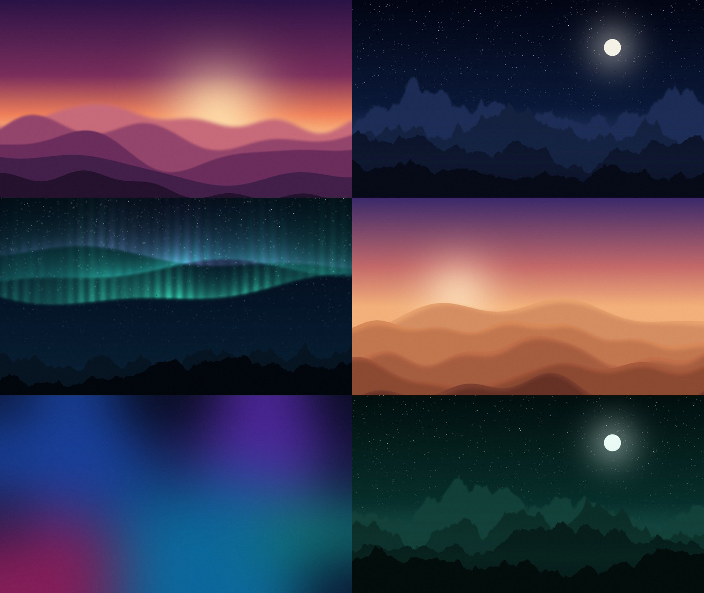

# Osmon — free Android TV launcher

**English** · [Русский](#русский)

Osmon (Uzbek for *sky*) is a lightweight home screen for Android TV / Google TV in the spirit of tvOS:
big focus-lift cards, a clock, a calm animated background — and **every theme is free**.



## Features

- **tvOS-style home screen**: Favorites row, HDMI/AV inputs row (switch to your console in one click), all apps grid.
- **Aerial videos** as a live wallpaper — the same Apple TV aerial clips, streamed in 1080p H.264 by Osmon's own lightweight player (works on TVs whose stock media player refuses background video).
- **11 built-in themes** with a slowly drifting gradient background, plus **6 wallpaper themes** in [`themes/`](themes).
- **Your own wallpapers**: picture, local video, or a slideshow from any folder.
- **Your own themes**: drop a folder into `/sdcard/Osmon/themes/` — that's it (see below).
- **22 languages** with an in-app switch: English, Русский, Oʻzbekcha, Қазақша, Кыргызча, Тоҷикӣ, Українська, Azərbaycan, Türkçe, Deutsch, Français, Español, Português, Italiano, Polski, العربية, हिन्दी, Bahasa Indonesia, Tiếng Việt, 中文, 日本語, 한국어.
- Favorites, ordering and hiding apps from the remote (long-press OK or the Menu key on an icon).
- Tiny: ~200 KB APK, no ads, no tracking, no internet needed except for aerial videos.

## Install

1. Download `Osmon.apk` from [Releases](../../releases).
2. Enable developer options and network/USB debugging on the TV, then from a computer with [platform-tools](https://developer.android.com/tools/releases/platform-tools):

```sh
adb connect <TV_IP>:5555
adb install -r Osmon.apk
adb shell pm grant uz.osmon.launcher android.permission.READ_EXTERNAL_STORAGE
adb shell cmd package set-home-activity uz.osmon.launcher/.MainActivity
```

3. Optional — copy the bundled wallpaper themes:

```sh
adb shell mkdir -p /sdcard/Osmon/themes
adb push themes/. /sdcard/Osmon/themes/
```

To go back to the stock home screen: `adb shell cmd package set-home-activity <other launcher activity>`.

## Making a theme

A theme is a folder in `/sdcard/Osmon/themes/`:

- one picture or video → a theme with that wallpaper;
- several pictures → a slideshow theme;
- an optional `theme.json`:

```json
{
  "name": "Mountains at night",
  "names": { "ru": "Горы ночью", "uz": "Tungi togʻlar" },
  "colors": ["#030614", "#0B1A3A", "#2A3F6E"],
  "glow": ["#3B82F6", "#6366F1", "#0EA5E9"],
  "accent": "#FFFFFF",
  "dim": 5,
  "wallpaper": "wallpaper.jpg",
  "slideshow": false
}
```

Use 1080p for video wallpapers — 4K makes most TV chips stutter.

## Aerial videos

The clip list in [`assets/aerial.json`](assets/aerial.json) comes from Apple's public tvOS aerial feed; the videos themselves
are not included and are streamed from Apple's servers. Android TVs don't trust the CA that signs Apple's video CDN, so Osmon
fetches those files over plain HTTP. If Apple changes the links, put a fresh `entries.json` (extracted from the feed's
`resources-*.tar`) on the TV as `/sdcard/Osmon/aerial.json` — no app update needed.

Osmon is an independent project and is not affiliated with or endorsed by Apple. Apple TV is a trademark of Apple Inc.

## Building

No Gradle, no Android Studio — just the SDK tools from Ubuntu packages:

```sh
sudo apt install openjdk-17-jdk aapt apksigner zipalign dalvik-exchange android-sdk-platform-23
python3 i18n/gen.py          # regenerate res/values-*/strings.xml from i18n/*.py
OSMON_KEY_PASS=... ./build.sh  # → build/Osmon.apk
```

The first build creates `osmon.keystore`. Keep it: updates must be signed with the same key. It is git-ignored.

- Code: `src/uz/osmon/launcher/` (plain Java, Android API 23+, no dependencies).
- Translations: add or fix a language in `i18n/t_*.py`, run `i18n/gen.py`; the script checks that nothing is missing.
- Wallpapers and the icon are generated by `tools/make_art.py`.

## License

[MIT](LICENSE). Pull requests with new themes and translations are welcome.

---

## Русский

**Osmon** («небо» по-узбекски) — бесплатный лаунчер для Android TV / Google TV в стиле Apple TV.

**Возможности**

- Главный экран как на tvOS: «Избранное», ряд входов HDMI/AV (переключение на приставку в одно нажатие), все приложения.
- **Видео с высоты** на фоне — те же ролики, что на Apple TV, в 1080p через собственный лёгкий плеер.
- 11 встроенных тем с плавно движущимся фоном и 6 тем с обоями в папке [`themes/`](themes).
- Свои обои: картинка, видео или слайдшоу из папки. Свои темы: просто папка в `/sdcard/Osmon/themes/`.
- 22 языка, переключение прямо в настройках.
- Избранное, порядок и скрытие приложений с пульта (долгое «ОК» или «Меню» на иконке).
- APK ~200 КБ, без рекламы и слежки.

**Установка** — скачай `Osmon.apk` из [Releases](../../releases) и выполни команды из раздела *Install* выше
(нужен `adb` и включённая отладка на ТВ). Темы с обоями копируются командой `adb push themes/. /sdcard/Osmon/themes/`.

**Своя тема** — папка с картинкой/видео (или несколькими картинками для слайдшоу) и, по желанию, `theme.json` (пример выше).
Видео лучше 1080p.

Osmon — независимый проект и не связан с Apple.
